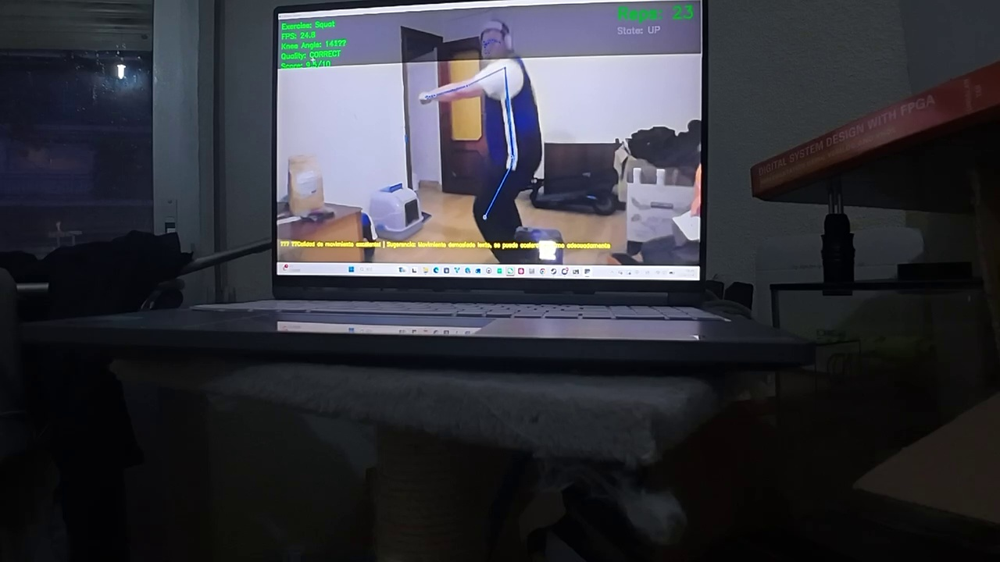
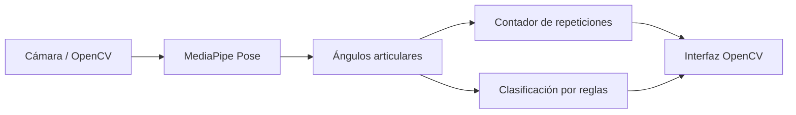

# CoachAI VisionAI · Entrenador personal virtual

Prototipo académico de visión por computador para analizar sentadillas y flexiones con una cámara: detecta la postura, calcula ángulos articulares, cuenta repeticiones y muestra feedback sobre la ejecución.

**Python · OpenCV · MediaPipe · NumPy · Java · Weka · jFuzzyLogic**

[Ver vídeo de demostración (14 s)](media/coachai-demo.mp4) · [Diseño del sistema (Word)](doc/CoachAI-Diseno-del-Sistema.docx) · [Estado de implementación](doc/ESTADO_IMPLEMENTACION.md)

[](media/coachai-demo.mp4)

## Qué hace

- Detecta los puntos de referencia del cuerpo con MediaPipe Pose y dibuja el esqueleto sobre la imagen.
- Calcula ángulos de rodillas, caderas, codos y hombros para analizar dos ejercicios: sentadillas y flexiones.
- Cuenta repeticiones con una máquina de estados y umbrales configurables.
- Muestra el estado del ejercicio, la puntuación de 0 a 10, los FPS y mensajes de feedback.
- Incluye módulos de extracción de características geométricas y temporales, así como herramientas de recopilación de datos.

El vídeo muestra una sesión de sentadillas del prototipo. La aplicación que se inicia con `python/main.py` utiliza **clasificación basada en reglas** (`HybridClassifier(use_ml=False)`). Los módulos Java de clasificación supervisada, selección genética de características y lógica borrosa se conservan en el repositorio como componentes separados; no forman parte de ese recorrido de ejecución por defecto.

## Flujo de la aplicación



## Ejecutar el prototipo

El proyecto conserva las versiones de dependencias de la entrega original. Para reproducir ese entorno, utiliza **Python 3.11**, un entorno virtual y una cámara. La instalación y la sesión completa con cámara deben comprobarse en el equipo de ejecución; no se ha certificado compatibilidad con Python 3.12 o posteriores.

### Windows · PowerShell

```powershell
git clone https://github.com/weiyinzhangupm-hue/coachai-visionai.git
cd coachai-visionai
py -3.11 -m venv .venv
.\.venv\Scripts\python.exe -m pip install -r requirements.txt
cd python
..\.venv\Scripts\python.exe main.py
```

### macOS / Linux

```bash
git clone https://github.com/weiyinzhangupm-hue/coachai-visionai.git
cd coachai-visionai
python3.11 -m venv .venv
source .venv/bin/activate
python -m pip install -r requirements.txt
cd python
python main.py
```

Selecciona `1` para sentadillas o `2` para flexiones. En la ventana de vídeo, pulsa `r` para reiniciar el contador y `q` para salir. El índice de cámara, la resolución y los umbrales se configuran en [`python/config.py`](python/config.py).

## Organización del código

| Ruta | Contenido |
| --- | --- |
| `python/pose_detector.py` | Detección de postura con MediaPipe |
| `python/angle_calculator.py` | Cálculo de ángulos articulares |
| `python/motion_tracker.py` | Estados y conteo de repeticiones |
| `python/rule_based_classifier.py` | Reglas de evaluación de sentadillas y flexiones |
| `python/hybrid_classifier.py` | Feedback y punto de extensión para un futuro modelo ML |
| `python/feature_extractor.py` | Características geométricas, temporales y normalización |
| `python/data_collector.py` | Recopilación de vídeos y características |
| `java/src/main/java/com/virtualtrainer/` | Clasificador Weka, algoritmo genético y motor de lógica borrosa |
| `flask_api/` | Capa de API y puente hacia Java |
| `tests/` | Scripts de pruebas originales |
| `doc/` | Diseño, documentación de la entrega y notas de implementación |
| `media/` | Vídeo original de demostración y fotograma de vista previa |

## Alcance y próximos pasos

El recorrido principal en Python funciona con reglas y no necesita un modelo entrenado. La carga y la predicción ML de `HybridClassifier` siguen siendo puntos pendientes de implementación. El repositorio no incluye un modelo entrenado, un dataset completo ni las dependencias JAR de Weka y jFuzzyLogic.

Los documentos de diseño describen también objetivos y componentes del planteamiento inicial. Para conocer el estado de esta versión y las comprobaciones realizadas, consulta las [notas de implementación](doc/ESTADO_IMPLEMENTACION.md). No se presentan porcentajes de precisión ni mejoras de rendimiento como resultados medidos.

Próximos pasos: preparar un conjunto de evaluación reproducible, completar la integración de los módulos de aprendizaje automático y automatizar las pruebas de los recorridos principales.

## Autores y procedencia

Proyecto académico en equipo de **Yitong Chen, Dakang Ye y Weiyin Zhang**, para la asignatura **Sistemas Inteligentes**, ETSISI · Universidad Politécnica de Madrid, curso 2025–2026.

Repositorio original: [UPM GitLab · VIRTUAL-TRAINER](https://gitlab.etsisi.upm.es/bq0073/virtual-trainer). Esta presentación para portfolio conserva el código y la atribución del proyecto e incorpora el documento de diseño y el vídeo de demostración facilitados por Weiyin Zhang. El README original se conserva en [`doc/README-original.md`](doc/README-original.md).

## English overview

Academic team project for webcam-based squat and push-up analysis. The Python application combines MediaPipe pose estimation, joint-angle calculations, repetition counting and rule-based feedback. The repository also contains separate Java modules for Weka classification, genetic feature selection and fuzzy feedback. The default demo uses the Python rule-based path; trained-model integration remains future work.
